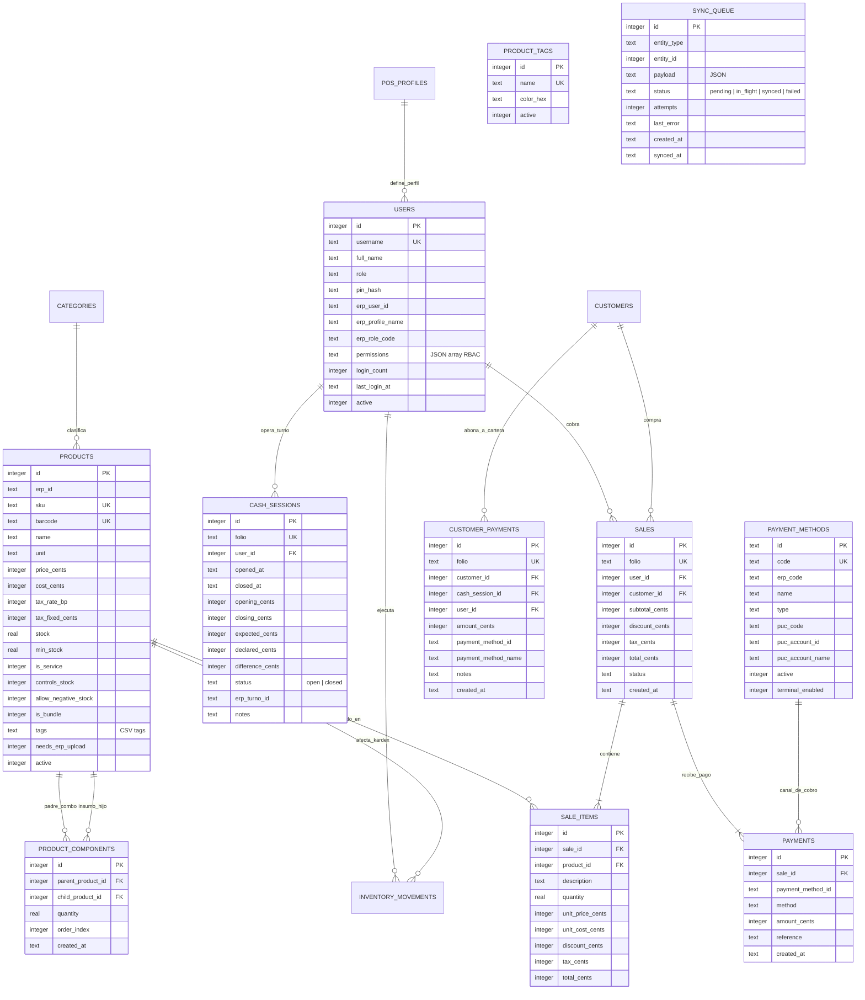
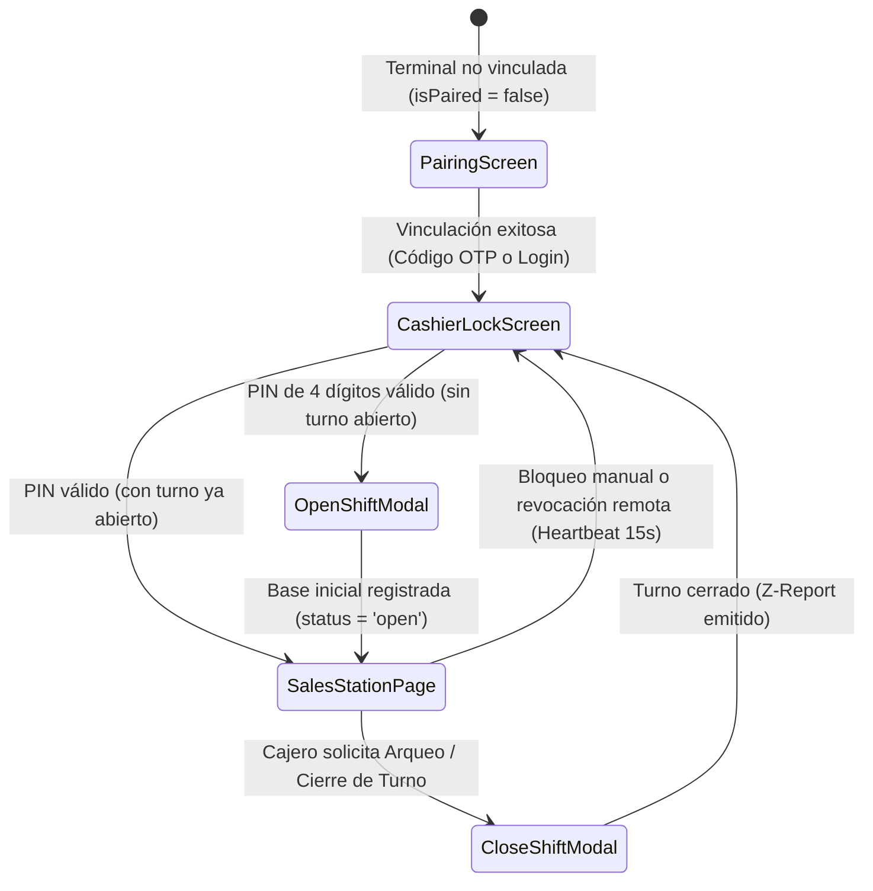

# 🏗️ Arquitectura Técnica y Estándares de Ingeniería — Logiventa POS

Documento de especificación técnica y directivas de diseño centradas exclusivamente en el cliente de escritorio **Logiventa POS** (`POS-Logiventa`).

---

## 🏛️ 1. Visión General del Stack Tecnológico

Logiventa POS es una aplicación de escritorio nativa de alto rendimiento (optimizada para Windows 10/11) con separación estricta entre presentación e infraestructura local:

| Capa | Tecnología | Rol Principal |
|---|---|---|
| **Contenedor Nativo** | [Tauri 2.x](https://tauri.app/) | Shell de escritorio seguro, gestión de ventanas, auto-actualizador (`tauri-plugin-updater`) y puente IPC |
| **Backend & Negocio** | Rust (Stable) | Motor 100% de lógica de negocio, validaciones ACID, cálculo de impuestos, control de turnos, acceso a hardware y demonios asíncronos (`tokio` / `reqwest`) |
| **Base de Datos Local** | SQLite embebido (`rusqlite`) | Persistencia relacional local compilada estáticamente (`bundled`), modo WAL y `foreign_keys = ON` |
| **Frontend UI** | React 19 + TypeScript 5.7+ | Capa de presentación reactiva, foco continuo del escáner, atajos de teclado globales y modales accesibles |
| **Bundler & Estilos** | Vite + Tailwind CSS v4 | Empaquetado rápido con HMR y soporte nativo de Modo Claro / Oscuro |

---

## 🔌 2. Capa de Comunicación IPC (Tauri Invoke Gateway)

El frontend React y el backend Rust se comunican mediante mensajes IPC asíncronos y eventos reactivos.

### 2.1. Regla de Oro del Gateway (`src/services/api.ts`)
> **PROHIBIDO** invocar `invoke(...)` de `@tauri-apps/api/core` o `listen(...)` de `@tauri-apps/api/event` directamente dentro de componentes o páginas de React.

Todas las llamadas están centralizadas y tipadas en `src/services/api.ts`:

```
[Componente React (SalesStationPage / ProductsPage / SettingsPage)]
        │
        ▼ (Llamada tipada: api.sales.create(input) / api.shifts.openShift(...))
[src/services/api.ts]
        │
        ▼ (invoke("create_sale", { input }))
[Tauri IPC Bridge (src-tauri/src/lib.rs -> generate_handler![])]
        │
        ▼ (#[tauri::command] pub fn create_sale)
[src-tauri/src/commands/*.rs]
        │
        ▼ (rusqlite::Connection::transaction)
[logiventa.db (SQLite Local)]
```

### 2.2. Catálogo Completo de Comandos IPC Registrados (`src-tauri/src/lib.rs`)

| Módulo Rust (`commands/`) | Namespace en `api.ts` | Comandos Expuestos (`#[tauri::command]`) | Responsabilidad Técnica |
| :--- | :--- | :--- | :--- |
| **`system.rs`** | `api.system` | `app_info`, `toggle_fullscreen`, `set_fullscreen`, `minimize_window`, `restart_app` | Metadatos de versión, control de ventana Kiosco (`F11`) y reinicio tras actualización. |
| **`auth.rs`** | `api.auth` | `get_terminal_status`, `validate_terminal_session`, `pair_terminal_code`, `pair_terminal_login`, `sync_users_from_erp`, `list_local_cashiers`, `login_cashier_pin`, `login_cashier_user_pin`, `unpair_terminal` | Vinculación M2M de terminal, descarga de cajeros y permisos RBAC, verificación local de PIN de 4 dígitos (BCrypt/SHA) y latido de sesión activa. |
| **`shifts.rs`** | `api.shifts` | `get_active_shift`, `open_shift`, `get_shift_summary`, `close_shift` | Ciclo de vida de turnos de caja (`cash_sessions`): apertura obligatoria con base inicial, consolidación de recaudos del turno y cierre con arqueo físico (Z-Report). |
| **`products.rs`** | `api.products` / `api.categories` / `api.tags` | `list_products`, `find_product_by_barcode`, `get_product`, `create_product`, `update_product`, `delete_product`, `adjust_stock`, `list_inventory_movements`, `list_product_tags`, `create_product_tag`, `update_product_tag`, `delete_product_tag`, `list_categories` | Búsqueda instantánea por código/SKU/nombre, CRUD de productos físicos y servicios, catálogo de etiquetas con color (`product_tags`), ajuste de stock y Kardex. |
| **`sales.rs`** | `api.sales` | `create_sale`, `get_last_sale`, `get_today_summary` | Registro atómico de ventas: cálculo de impuestos, inserción de cabecera/ítems (con `unit_cost_cents`) y pagos, descuento de stock local, encolado en `sync_queue` e impresión ESC/POS. |
| **`customers.rs`** | `api.customers` | `get_customers`, `search_customers`, `create_customer` | Directorio local de clientes (`F2`), búsqueda rápida por nombre/NIT/teléfono y alta en mostrador. |
| **`settings.rs`** | `api.settings` | `get_all_settings`, `update_settings` | Lectura/escritura de ajustes clave-valor (`settings`). |
| **`printers.rs`** | `api.printers` / `api.settings` | `list_system_printers`, `test_print_ticket`, `test_open_drawer`, `print_sale_ticket`, `print_shift_ticket` | Motor de impresión térmica directa ESC/POS (`CP437`/`CP850` vía `encode_escpos_text`) para tickets de venta, Comprobantes Z de Cierre de Caja y pulso RJ11 de gaveta. |
| **`excel_io.rs`** | `api.products` | `preview_products_xlsx`, `execute_products_xlsx_import`, `export_products_xlsx` | Motor nativo de importación y exportación masiva de inventario `.xlsx` compatible con formato Eleventa. |
| **`sync.rs`** | `api.sync` | `verify_and_reserve_stock`, `release_stock_reservation`, `sync_catalog_from_erp`, `dispatch_sync_outbox`, `pull_inventory_deltas`, `get_sync_status`, `sync_payment_methods`, `get_payment_methods`, `toggle_payment_method_terminal_status` | Demonio asíncrono de sincronización (ventas, abonos, devoluciones, PINs y cierres de turno `cash_session` con Dead-Letter automático), reserva temporal de stock crítico y descarga de catálogo/deltas. |
| **`images.rs`** | `api.images` | `save_product_image_local`, `delete_product_image_local`, `get_product_image_base64` | Almacenamiento local de imágenes de productos en `%APPDATA%\com.briankrou.pos-logiventa\images\`, cálculo de hash SHA-256, sincronización de estados y lectura Base64. |

---

## 💰 3. Estándares Financieros y Matemáticos Críticos

Para erradicar cualquier error acumulativo de coma flotante IEEE 754:

### 3.1. Representación Monetaria (Centavos Enteros)
- **Base de Datos (SQLite)**: Tipo `INTEGER` obligatorio.
- **Backend (Rust)**: Tipo `i64` obligatorio.
- **Frontend (TypeScript)**: Tipo `number` entero.
- **PROHIBIDO** el uso de floats/doubles (`f32`, `f64`, `number` decimal) para precios, costos, subtotales, impuestos, bases de caja o pagos.
- Conversión y visualización en UI (`src/lib/money.ts`):
  - `formatCents(cents: number)`: Formatea centavos a moneda legible (`$1,250.00`).
  - `toCents(amount: number | string)`: Entrada segura con redondeo entero `Math.round(val * 100)`.

### 3.2. Tasas Impositivas en Puntos Base (BP) e Impuestos Nominales
- **Impuesto Porcentual (`tax_rate_bp`)**: 1% equivale a 100 puntos base (`1900` = 19.00%, `1600` = 16.00%, `500` = 5.00%, `0` = 0.00%).
- **Impuesto Nominal Fijo (`tax_fixed_cents`)**: Impuesto en centavos por unidad vendida (ej. impuesto a bolsas plásticas o bebidas ultraprocesadas).
- Fórmula de cálculo en Rust con redondeo bancario al centavo más cercano:
  ```rust
  let pct_tax = (subtotal_cents * tax_rate_bp + 5000) / 10000;
  let fixed_tax = ((tax_fixed_cents as f64) * quantity).round() as i64;
  let tax_cents = pct_tax + fixed_tax;
  ```

### 3.3. Cuadre Transaccional Obligatorio, Costo Histórico y Trazabilidad de Cajero
Toda venta valida en Rust antes del `COMMIT`:
$$\text{Total} = \text{Subtotal} + \text{Impuestos} - \text{Descuentos}$$
$$\sum \text{Pagos} \ge \text{Total}$$
$$\text{Cambio} = \sum \text{Pagos} - \text{Total}$$
- **Costo Histórico**: Cada registro en `sale_items` congela en `unit_cost_cents` el `cost_cents` vigente del producto al instante de la venta.
- **Trazabilidad Individual de Cajero**: Cada venta almacena `user_id` del operador autenticado con PIN al momento de cobrar, y el Outbox serializa `userId`, `erpUserId` y `cajeroNombre`. Esto permite que varios cajeros compartan el mismo turno (`session_id`) durante relevos sin perder la autoría individual de cada ticket en reportes de auditoría y comisiones.

### 3.4. Política de Inventario Estricto y Eliminación Segura en Mostrador
- **Bloqueo Inflexible de Stock Cero (`stock <= 0`)**: Los productos físicos con existencias agotadas o en cero no pueden ser agregados al ticket bajo ninguna circunstancia (ni por escaneo de código de barras ni desde el buscador rápido `F10`), previniendo descuadres entre el mostrador y el almacén.
- **Validación de Capacidad Disponible en Ticket**: Al escanear o incrementar cantidad (`+` o edición manual), el POS comprueba que la suma requerida no sobrepase el inventario disponible en SQLite (`currentInCart + qty <= product.stock`). Los servicios (`is_service = 1`) quedan exentos de esta restricción.
- **Eliminación Segura y Prevención de Cascada**:
  - Al decrementar la cantidad con `-` hasta 0, el producto es removido del ticket y el índice de selección activa se restablece a inactivo (`selectedLineIndex = -1`), impidiendo que pulsaciones repetidas de `-` eliminen en cascada las líneas precedentes.
  - El manejador de teclado valida que no haya texto en el campo de escaneo antes de ejecutar `+` o `-`, evitando disparar modificaciones de cantidad cuando el cajero digita códigos que contienen guiones.
- **Confirmación Obligatoria para Producto #1**: Intentar eliminar la primera línea del ticket (o la única existente) mediante `-` o `Supr` (`Delete`) despliega una ventana de confirmación obligatoria `confirm(...)` para evitar la pérdida involuntaria de tickets con un solo ítem.

---

## 🗄️ 4. Esquema de Base de Datos Local y Migraciones (`0001` a `0022`)

La base de datos SQLite se almacena en `%APPDATA%\com.briankrou.pos-logiventa\logiventa.db`.

### 4.1. Diagrama Entidad-Relación Completo (Esquema v16)



### 4.2. Historial de Migraciones (`src-tauri/src/db/migrations.rs`)
El runner aplica secuencialmente las 22 migraciones dentro de transacciones individuales actualizando `PRAGMA user_version`:

1. `0001_initial.sql`: Tablas nucleares (`users`, `categories`, `products`, `customers`, `cash_sessions`, `sales`, `sale_items`, `payments`, `inventory_movements`, `settings`).
2. `0002_terminal_settings.sql`: Columnas `erp_user_id` y llaves de vinculación M2M en `settings`.
3. `0003_hardware_settings.sql`: Parámetros de impresora térmica ESC/POS, cajón RJ11 y lector de códigos.
4. `0004_product_services.sql`: Indicador `is_service` para facturación de servicios sin inventario físico.
5. `0005_sync_queue.sql`: Tabla `sync_queue` para el patrón Transactional Outbox.
6. `0006_product_erp_id.sql`: Columna `erp_id` en `products` para trazabilidad bidireccional.
7. `0007_product_sync_flag.sql`: Bandera `needs_erp_upload` para productos dados de alta directamente en caja.
8. `0008_payment_methods.sql`: Tabla `payment_methods` con cuentas PUC asociadas y semilla offline inicial.
9. `0009_cash_shifts.sql`: Extensión de `cash_sessions` con `folio`, `status`, `erp_turno_id`, `declared_cents` y `difference_cents`.
10. `0010_dynamic_payments.sql`: Eliminación de restricción `CHECK` rígida en `payments` para soportar medios dinámicos y columna `terminal_enabled` en `payment_methods`.
11. `0011_user_permissions.sql`: Columna JSON `permissions` en `users` para RBAC local.
12. `0012_pos_profiles_and_granular_rbac.sql`: Tabla `pos_profiles` y columnas `erp_profile_name`, `erp_role_code`, `last_login_at` y `login_count`.
13. `0013_clean_dummy_profiles.sql`: Limpieza de registros semilla de desarrollo.
14. `0014_product_policies_and_tags.sql`: Columnas `controls_stock`, `allow_negative_stock`, `is_bundle`, `tags` y `tax_fixed_cents` en `products`.
15. `0015_sale_items_historical_cost.sql`: Columna `unit_cost_cents` en `sale_items`.
16. `0016_product_tags.sql`: Tabla `product_tags` con colores hexadecimales predefinidos.
17. `0017_pin_rate_limiting.sql`: Columnas `failed_pin_attempts` y `locked_until` en `users` para protección contra fuerza bruta local (suspensión de 60s tras 5 intentos fallidos).
18. `0018_product_components.sql`: Tabla `product_components` para recetas, combos y kits con explosión atómica de inventario.
19. `0019_customer_credit_and_payments.sql`: Soporte integral de cartera de clientes (`credit_limit_cents`, `current_balance_cents`, `is_credit_blocked`, `credit_days`, `notes`) y tabla `customer_payments` para abonos en caja.
20. `0020_sync_queue_customer_payments.sql`: Extensión de la cola outbox (`sync_queue`) para eventos de abonos de cartera de clientes.
21. `0021_product_images.sql`: Columnas `image_path`, `image_hash` y `image_sync_status` en `products` para gestión de fotografía local y sincronización.
22. `0022_strict_no_negative_stock.sql`: Forzado de política estricta de inventario en BD (`allow_negative_stock = 0` y `controls_stock = 1` para artículos físicos y combos).
23. `0023_sale_returns.sql`: Tablas `sale_returns` y `sale_return_items` para devoluciones de mercancía (`restock` vs `merma`) y reembolsos en efectivo o cruce de cartera.
24. `0024_sale_reprint_count.sql`: Contador auditable `reprint_count` en `sales` para controlar copias de tickets impresos.
25. `0025_terminal_license.sql`: Columnas de control de plan y vigencia de licencia de la terminal.
26. `0026_user_permission_audit.sql`: Tabla `user_permission_audit` para bitácora local de cambios de permisos RBAC.
27. `0027_eleventa_fields.sql`: Columnas `wholesale_price_cents` (precio mayoreo) y `max_stock` (inventario máximo) en `products`.
28. `0028_sales_paid_and_change_cents.sql`: Columnas `paid_cents` y `change_cents` en `sales` para separar el monto entregado por el cliente del efectivo neto retenido en `payments`.
29. `0029_fix_user_permission_audit_trigger.sql`: Reparación de la columna `last_modified_by` en `users` y trigger `trg_user_permissions_audit` junto con saneamiento idempotente `ensure_critical_schema` en cada arranque.

---

## 🔄 5. Motor de Sincronización Local y Reserva de Stock (`commands/sync.rs`)

1. **Demonio Asíncrono en Rust (`start_sync_daemon`)**:
   - Se lanza al iniciar la aplicación en `lib.rs` mediante `tauri::async_runtime::spawn` con un ciclo de 15 segundos.
   - En cada ciclo:
     1. Despacha ventas pendientes en `sync_queue` (`dispatch_sync_outbox`).
     2. Sube productos creados localmente con `needs_erp_upload = 1` y descarga cambios del catálogo remoto (`sync_catalog_from_erp`).
     3. Descarga deltas incrementales de inventario (`pull_inventory_deltas`) para reflejar ventas ocurridas en otras cajas.
     4. Emite el evento `sync-status-changed` hacia React con `{ isOnline, pendingCount, lastSyncedAt, lastError }`.

2. **Prevención de Colisiones en Stock Crítico (`verify_and_reserve_stock`)**:
   - Al presionar `F12` para cobrar, el POS evalúa primero las existencias en SQLite local.
   - Si algún producto físico tiene stock crítico ($\le \text{umbral}$, por defecto `2.0`), solicita una reserva temporal de 90 segundos al servidor antes de abrir el modal de cobro.
   - Si el cajero cierra el modal sin cobrar (`Esc`), el POS invoca `release_stock_reservation` para liberar las unidades inmediatamente.
   - Si no hay internet, aplica la política local (`offline_stock_policy`: `permissive` por defecto) para jamás detener la fila en mostrador.

---

## 🔐 6. Seguridad Local, Control de Acceso RBAC y Ciclo de Sesión

El componente raíz [`src/App.tsx`](file:///c:/Users/BrianKrou/OneDrive/Documentos/PROYECTOS%20-%20JBone/Megalider/POS-Logiventa/src/App.tsx) aplica una máquina de estados de 4 niveles antes de permitir cualquier cobro:



1. **Evaluación de Permisos en Frontend (`src/lib/permissions.ts`)**:
   - `F3` (Catálogo): Requiere `inventario:ver`.
   - `F4` (Ajustes de Inventario / Kardex): Requiere `inventario:ver` o `inventario:ajustar`.
   - `F7` (Configuración de Hardware y Terminal): Requiere `pos:configuracion`.
2. **Protección Anti Fuerza Bruta de PIN Local (Rate Limiting)**:
   - Al intentar autenticar en `commands/auth.rs`, el sistema verifica `failed_pin_attempts` y `locked_until`.
   - Si se registran **5 intentos erróneos consecutivos**, el usuario queda bloqueado localmente durante **60 segundos**, impidiendo ataques automatizados o de tanteo sobre el teclado numérico de la terminal.
3. **Respaldo Automático Preventivo al Cierre de Turno (`commands/shifts.rs`)**:
   - Durante la emisión del Z-Report de cierre de turno (`close_shift`), SQLite ejecuta un snapshot atómico en caliente mediante `VACUUM INTO 'backup_turno_{FOLIO}.db'`.
   - Garantiza que ante un fallo de hardware catastrófico o corrupción del disco, siempre exista una copia exacta e inmutable del estado contable y de inventario al momento del corte.
4. **Latido de Seguridad (Session Heartbeat cada 15s)**:
   - `App.tsx` invoca periódicamente `api.auth.validateSession(activeCashier.erpUserId)`.
   - Si la caja fue desvinculada o el usuario activo fue desactivado/degradado remotamente (`activeCashierRevoked: true`), el POS cierra la sesión de inmediato y bloquea la pantalla.

---

## 🎨 7. Sistema Estándar de Modales UI, Ergonomía y Subsistema de Imágenes

- **Prohibición de Diálogos Nativos**: Queda estrictamente prohibido invocar `window.alert()` y `window.confirm()`.
- **Sistema Centralizado de Modales (`src/contexts/ModalContext.tsx`)**:
  - `confirm(options)`: Retorna una `Promise<boolean>` con soporte de confirmación por `Enter` y cancelación por `Escape`.
  - `alert(options)`: Retorna una `Promise<void>` para notificaciones operativas y de seguridad.
- **Navegación Universal por Teclado (`Enter` / `Escape`) en Todos los Diálogos**:
  - Todos los modales del sistema cuentan con escuchadores globales (`window.addEventListener('keydown')`) que capturan:
    - **`Enter`**: Confirma la acción primaria, envía formularios o selecciona el elemento activo (ej. cobro en `CobroModal`, alta en `CustomerModal`, selección en `SearchProductModal`, confirmación en `ConfirmModal`, cierre en `AlertModal` y `ImageLightboxModal`).
    - **`Escape`**: Cancela y cierra limpiamente cualquier diálogo abierto (`CloseShiftModal`, `OpenShiftModal`, `VariosModal`, `SearchProductModal`, `CustomerModal`, `CobroModal`, modales de confirmación y lightbox) sin requerir interacción con el ratón.
- **Vistas Superpuestas sin Desmontar Ventas**: En `App.tsx`, `SalesStationPage` se mantiene permanentemente montada en el DOM (ocultándose con `hidden` al navegar a `ProductsPage` o `SettingsPage`), garantizando preservación total del estado de los tickets y retorno instantáneo con `F1`.
- **Subsistema de Imágenes y Visualizador Lightbox**:
  - **Almacenamiento Local de Assets**: Las imágenes de productos se guardan en el sistema de archivos local (`%APPDATA%\com.briankrou.pos-logiventa\images\`) mediante `commands/images.rs`, con deduplicación por hash SHA-256 e interoperabilidad offline-first.
  - **Generación Dinámica de Placeholders SVG (`src/lib/images.ts`)**: Cuando un producto no tiene imagen asignada o no es posible cargarla, el helper `getProductFallbackSvg(type)` genera un SVG vectorial inline codificado en Data URI, coloreado e identificado según la tipología:
    - 📦 *Producto Físico*: Ícono azul de caja / paquete de almacén.
    - 🛠️ *Servicio*: Ícono verde esmeralda con herramientas de servicio técnico.
    - 🍱 *Combo / Kit / Receta*: Ícono púrpura con bandeja y cubiertos de combo.
  - **Visor Lightbox Modal (`ImageLightboxModal`)**: Las imágenes en miniatura del catálogo (`ProductsPage`) y de las líneas del ticket de venta (`SalesStationPage`) admiten **doble clic** para expandirse a pantalla completa en alta resolución. El lightbox se cierra al hacer clic en el backdrop o presionando `Escape` / `Enter`.
  - **Visibilidad Opcional de Miniaturas en Venta**: La cabecera de la estación de cobro incluye un interruptor visual para ocultar o mostrar las miniaturas de productos en el ticket, adaptando la densidad de información a pantallas compactas o táctiles.

---

## 🧪 8. Protocolo de Pruebas y Calidad de Código

Antes de generar un commit o compilación de distribución:

1. **Chequeo de Tipos TypeScript**:
   ```bash
   npm run typecheck
   ```
   *Debe finalizar con 0 errores.*

2. **Tests Unitarios del Backend Rust**:
   ```bash
   npm run test:rust
   ```
   *Verifica la aplicación limpia e idempotente de las 16 migraciones sobre SQLite en memoria y las reglas de cálculo.*

3. **Compilación de Producción**:
   ```bash
   npm run tauri build
   ```
   *Genera el instalador optimizado en `src-tauri/target/release/bundle/nsis/`.*
