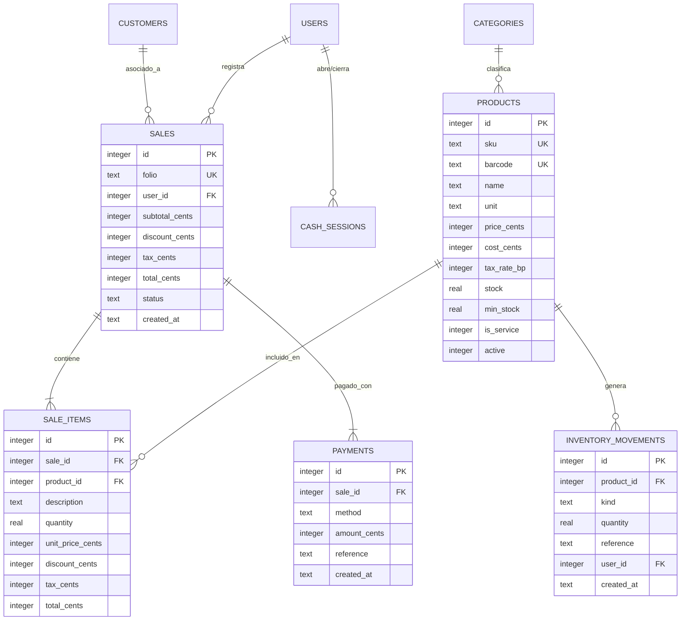

# 🏗️ Arquitectura Técnica y Estándares de Ingeniería — Logiventa POS

Documento de especificación técnica y directivas de diseño para ingenieros de software, contribuidores y mantenedores del sistema.

---

## 🏛️ 1. Visión General del Stack Tecnológico

Logiventa POS es una aplicación de escritorio nativa multiplataforma (enfocada en Windows 10/11) con separación estricta entre presentación e infraestructura:

| Capa | Tecnología | Rol Principal |
|---|---|---|
| **Contenedor Nativo** | [Tauri 2.x](https://tauri.app/) | Shell de escritorio seguro, gestión de ventanas y bindings de bajo nivel |
| **Backend & Negocio** | Rust (Edición 2024 / Stable) | Motor de lógica de negocio, validaciones ACID, cálculo de impuestos, acceso a hardware y SQLite embebido |
| **Base de Datos Local** | SQLite embebido (`rusqlite`) | Persistencia relacional local con modo WAL y foreign keys activadas |
| **Frontend UI** | React 19 + TypeScript 5.7+ | Capa de presentación reactiva, gestión de foco continuo, atajos de teclado y modales |
| **Bundler & Estilos** | Vite + Tailwind CSS v4 | Empaquetado optimizado con recarga rápida (HMR) y tokens corporativos Megalider |

---

## 🔌 2. Capa de Comunicación IPC (Tauri Invoke Gateway)

El frontend y el backend se comunican mediante mensajes IPC asíncronos y serializados en JSON.

### Regla de Oro del Gateway:
> **PROHIBIDO** invocar `invoke(...)` de `@tauri-apps/api/core` directamente dentro de componentes o páginas de React.

Todas las invocaciones deben concentrarse exclusivamente en el objeto exportado en `src/services/api.ts`, asegurando un tipado bidireccional estricto:

```
[Componente React]
        │
        ▼ (Llamada tipada: api.products.list(search))
[src/services/api.ts]
        │
        ▼ (invoke("list_products", { search }))
[Tauri IPC Bridge]
        │
        ▼ (#[tauri::command] pub fn list_products)
[src-tauri/src/commands/products.rs]
        │
        ▼ (rusqlite::Connection con transacción)
[logiventa.db (SQLite)]
```

---

## 💰 3. Estándares Financieros y Matemáticos Críticos

El sistema maneja transacciones monetarias y facturación comercial en vivo. Para erradicar cualquier error acumulativo de coma flotante IEEE 754:

### 3.1. Representación Monetaria (Centavos Enteros)
- **Base de Datos (SQLite)**: Tipo `INTEGER` obligatorio.
- **Backend (Rust)**: Tipo `i64` obligatorio.
- **Frontend (TypeScript)**: Tipo `number` entero.
- **PROHIBIDO** el uso de floats/doubles (`f32`, `f64`, `number` decimal) para precios, costos, subtotales o impuestos.
- Conversión y visualización:
  - `formatCents(cents: number)`: `$1,250.00`
  - `toCents(amount: number | string)`: Entrada segura con redondeo `Math.round(val * 100)`.

### 3.2. Tasas Impositivas en Puntos Base (Basis Points - BP)
- 1% equivale a 100 puntos base:
  - `1600` = 16.00% (IVA estándar)
  - `1900` = 19.00% (IVA general)
  - `500` = 5.00% (IVA reducido)
  - `0` = 0.00% (Exento)
- Fórmula de redondeo bancario en Rust al centavo más cercano:
  ```rust
  let tax_cents = (subtotal_cents * tax_rate_bp + 5000) / 10000;
  ```

### 3.3. Cuadre Transaccional Obligatorio (Zero-Difference)
Toda venta debe satisfacer de forma estricta:
$$\text{Total} = \text{Subtotal} + \text{Impuestos} - \text{Descuentos}$$
$$\sum \text{Pagos} \ge \text{Total}$$
$$\text{Cambio} = \sum \text{Pagos} - \text{Total}$$

---

## 🗄️ 4. Esquema de Base de Datos y Modelo de Datos Local

La base de datos SQLite se almacena en `%APPDATA%\com.briankrou.pos-logiventa\logiventa.db`.

### 4.1. Tablas Principales



### 4.2. Inmutabilidad de Migraciones
Las migraciones residen en `src-tauri/migrations/`.
- El runner `src-tauri/src/db/migrations.rs` ejecuta cada script dentro de una transacción atómica y actualiza `PRAGMA user_version`.
- **Nunca modificar un archivo SQL existente**; para cualquier alteración de esquema, debe crearse un nuevo archivo consecutivo `000N_descripcion.sql` y agregarse al array `MIGRATIONS`.

---

## 🔄 5. Integración y Sincronización con Megalider ERP

1. **Emparejamiento Seguro (M2M Pairing)**:
   - La terminal se vincula a una empresa y caja registrada en el ERP mediante código de un solo uso o credenciales de administrador.
   - Las credenciales M2M se guardan localmente en la tabla `settings`.
2. **Sync Outbox**:
   - Cada venta local confirmada en SQLite genera una entrada en la cola de sincronización.
   - Cuando hay conectividad, un proceso despacha las ventas hacia el ERP.
   - Al recibirse en el ERP, se dispara el **Motor Contable v6.2**, generando asientos de partida doble con hash criptográfico SHA-256 encadenado.
3. **Catálogo y Precios**:
   - Las actualizaciones de precios en la nube se descargan periódicamente a la tabla `products` local sin bloquear la pantalla de ventas en uso.

---

## 🎨 6. Sistema Estándar de Modales UI

Siguiendo las directivas de experiencia de usuario:
- Queda terminantemente prohibido invocar `window.alert()` y `window.confirm()`.
- Se utiliza el hook `useModals()` de `src/contexts/ModalContext.tsx`:
  - `confirm(options)`: Retorna una `Promise<boolean>` accesible con `Enter` (confirmar) y `Escape` (cancelar).
  - `alert(options)`: Retorna una `Promise<void>` para errores y notificaciones críticas.
- Todos los modales implementan desenfoque de fondo (`backdrop-blur-xs`), animaciones fluidas y soporte completo de Modo Claro y Oscuro.

---

## 🧪 7. Protocolo de Pruebas y Calidad de Código

Antes de generar un commit o distribución ejecutable:

1. **Chequeo de Tipos TypeScript**:
   ```bash
   npm run typecheck
   ```
   *Debe retornar 0 errores.*

2. **Tests Unitarios del Backend Rust**:
   ```bash
   npm run test:rust
   ```
   *Verifica la aplicación limpia de migraciones sobre bases de datos en memoria y la consistencia de los modelos.*

3. **Compilación de Producción**:
   ```bash
   npm run tauri build
   ```
   *Genera el ejecutable empaquetado optimizado en `src-tauri/target/release/`.*
